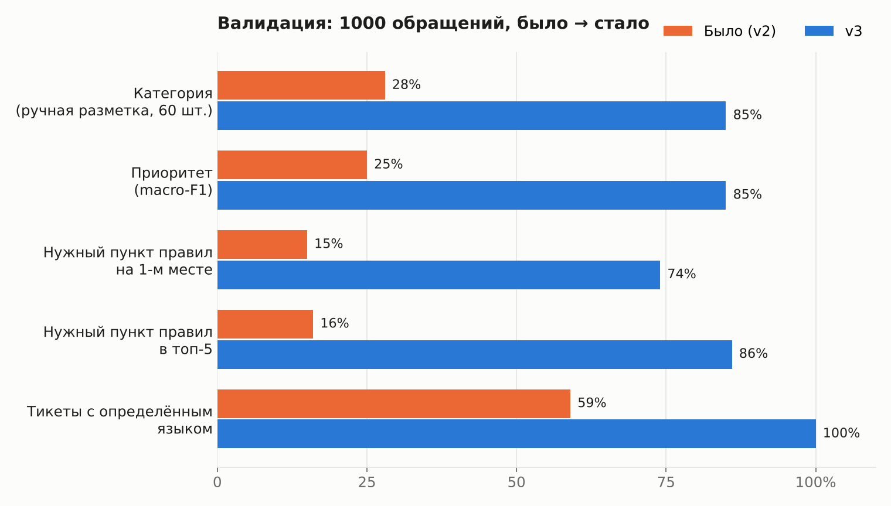
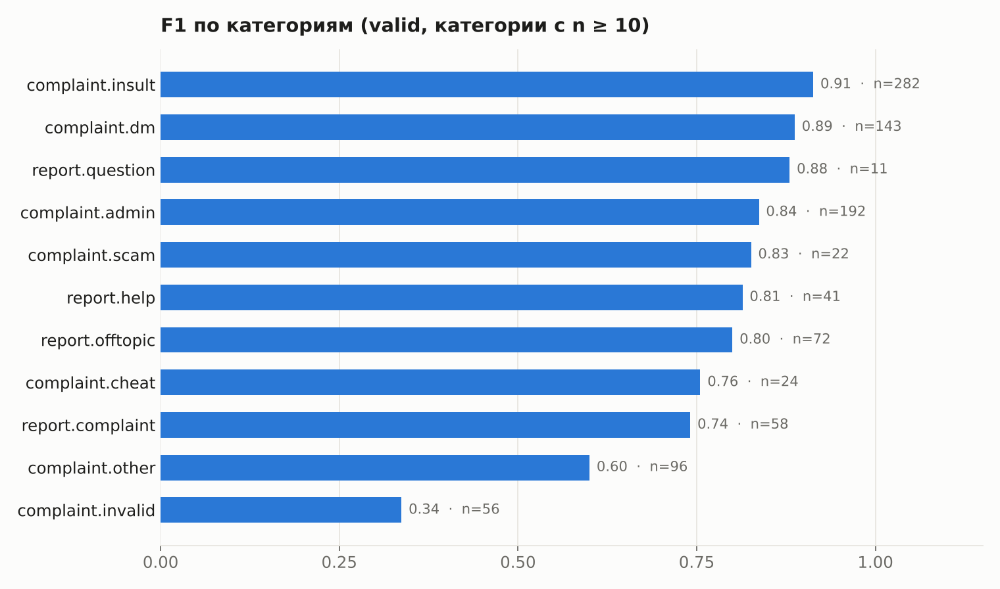
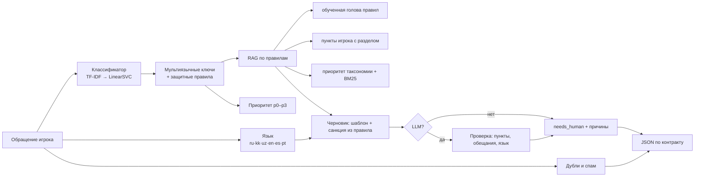
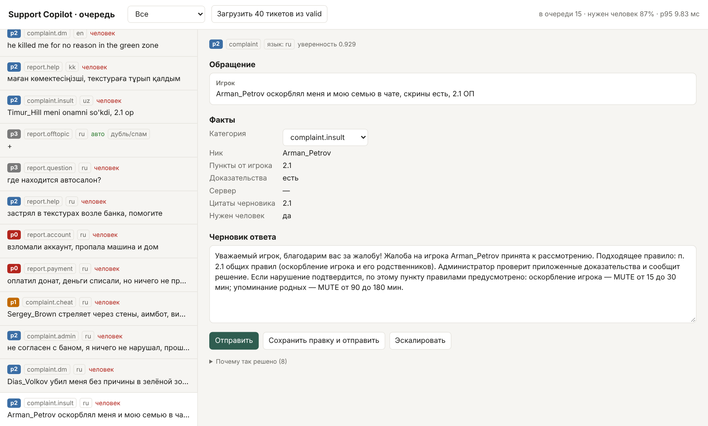

# Grand Mobile · Support Copilot

**Триаж обращений игроков для Grand Mobile (Decentrathon 6.0, кейс 03).**
Сервис определяет язык, категорию и приоритет обращения, отсеивает дубли и спам, извлекает факты,
пишет черновик ответа на языке игрока со ссылками на пункты правил и решает, нужен ли человек.

- 🧠 Классификатор обучен на **118 тыс. реальных обращений**: разметка восстановлена из исходов в ответах админов
- 📚 RAG по правилам с обученной «головой правил» и разбором разделов (ОП / GZ / ЖБ)
- 🌍 Черновики на **6 языках игры**: ru · kk · uz · en · es · pt
- 🛡️ **0 выдуманных пунктов** и **0 обещаний** разбана, возврата или наказания на валидации
- ⚡ **~7 мс** на обращение на CPU, **$0** за обращение; LLM по желанию
- 🖥️ Интерфейс админа: очередь, черновик, кнопки «отправить / править / эскалировать»



---

## Результаты

Валидация: `tickets_valid.jsonl`, 1000 обращений (817 жалоб, 183 репорта). Скрытый тест не использовался.

| Метрика | Было (v2) | **v3** |
|---|---:|---:|
| Категория, ручная разметка, 60 «свежих» обращений | 17/60 (28%) | **51/60 (85%)** |
| Категория, совпадение с weak-разметкой (1000) | 34.7% | **81.2%** |
| Приоритет, macro-F1 | 0.25 | **0.85** |
| Нужный пункт правил на 1-м месте (346 жалоб с цитатой админа) | 0.15 | **0.74** |
| Нужный пункт правил в топ-5 | 0.16 | **0.86** |
| Цитаты черновиков, существующие в `rules.json` | — | **675 / 675** |
| Обещания разбана / возврата / наказания | — | **0** |
| Обращения без определённого языка | 406 | **0** |
| Латентность без LLM, p50 / p95 | ~3 с | **3 / 7 мс** |
| Доля «нужен человек»: всего / жалобы / репорты | 100% | 92% / 97% / 68% |
| Стоимость обращения | $0 | **$0** (CPU) |

<details>
<summary>Как получены цифры и чего они не доказывают</summary>

- **Weak-разметка** выводится из ответа админа (код нарушения `2.1 ОП`, `1.2 GZ`, вердикт, апелляция). Это не человеческая разметка.
- **Ручная разметка**: 160 обращений размечены одним разметчиком по тексту игрока и `taxonomy.json`
  (100 dev, по ним настраивались правила, и 60 свежих). На свежих 60 первый прогон дал 42/60,
  после доработки правил разметки — 51/60. Честный диапазон: 70–85%.
- **Retrieval-gold** — пункт, который админ реально процитировал в ответе.
- Подробности и ограничения: [docs/REPORT.md](docs/REPORT.md).
</details>



Самое слабое место — `complaint.invalid` и `complaint.other`: граница между ними размыта уже в таксономии.

---

## Быстрый старт

Нужен Python 3.11+. Данные кейса в репозитории не хранятся, их надо положить в `.private/data/`:

```
.private/data/
├── rules.json
├── taxonomy.json
├── tickets_train.jsonl.gz   # нужен только для обучения
└── tickets_valid.jsonl      # нужен только для оценки
```

### Windows (PowerShell)

```powershell
python -m venv .venv; .\.venv\Scripts\Activate.ps1
pip install -e ".[dev,llm]"
.\scripts\run-v3.ps1 -Action train -Python python      # ~2 мин на CPU → .private/v3/model_v3.pkl.gz
.\scripts\run-v3.ps1 -Action test  -Python python      # тесты
.\scripts\run-v3.ps1 -Action serve -Python python      # http://127.0.0.1:8000/
.\scripts\run-v3.ps1 -Action predict -Python python -InputPath examples\demo_tickets.jsonl -OutputPath pred.jsonl
```

### Linux / macOS

```bash
python -m venv .venv && source .venv/bin/activate
pip install -e ".[dev,llm]"
make train                                        # обучение, ~2 мин на CPU
make test                                         # тесты
make serve                                        # http://127.0.0.1:8000/
make predict IN=examples/demo_tickets.jsonl OUT=pred.jsonl
```

Без make: `python -m support_copilot.cli {train|serve|predict}` (с `PYTHONPATH=src` или после `pip install -e .`).

### LLM по желанию

LLM только переписывает готовый черновик. Подходит любой OpenAI-совместимый сервер, например `llama-server` из llama.cpp:

```bash
export COPILOT_V3_LLM_URL=http://127.0.0.1:8081   # PowerShell: $env:COPILOT_V3_LLM_URL="..."
export COPILOT_V3_LLM_MODEL=local                 # опционально; COPILOT_V3_LLM_KEY для облака
```

Ответ LLM отбрасывается и остаётся шаблон, если в нём пункт не из найденных, обещание,
потерянная цитата, кириллица в узбекском ответе или таймаут больше 3.5 с.

---

## API

### `POST /triage`

```bash
curl -s http://127.0.0.1:8000/triage -H "Content-Type: application/json" -d '{
  "kind": "complaint",
  "messages": [{"role": "player", "text": "Arman_Petrov оскорблял меня и мою семью в чате, скрины есть, 2.1 ОП", "attachments": 2}]
}'
```

```json
{
  "lang": "ru",
  "category": "complaint.insult",
  "priority": "p2",
  "is_spam_or_duplicate": false,
  "extracted": {"nickname": "Arman_Petrov", "rule_refs": ["2.1"], "has_evidence": true, "server": null},
  "draft_reply": {
    "lang": "ru",
    "text": "Уважаемый игрок, благодарим вас за жалобу! Жалоба на игрока Arman_Petrov принята к рассмотрению. Подходящее правило: п. 2.1 общих правил (оскорбление игрока и его родственников). Администратор проверит приложенные доказательства и сообщит решение. Если нарушение подтвердится, по этому пункту правилами предусмотрено: …",
    "cited": ["2.1"]
  },
  "needs_human": true,
  "confidence": 0.929,
  "reasons": ["classifier=tfidf_svm_weak_labels conf=0.93 margin=0.91", "cited_id=rules:30:2.1", "needs_human=punishment_decision_requires_admin_and_screenshots", "…"]
}
```

| Эндпоинт | Назначение |
|---|---|
| `POST /triage` | триаж по контракту кейса (ответ на некорректный ввод — 422) |
| `GET /ready` | готовность, хэш модели, p95, статистика LLM |
| `GET /` | интерфейс админа |
| `GET /api/queue` | очередь обращений |
| `POST /api/feedback` | `{id, action: send\|edit\|escalate, text, category?}` → `.private/v3/feedback.jsonl` |
| `POST /api/queue/demo?n=40` | загрузить в очередь N обращений из `tickets_valid.jsonl` |

Сервер написан на стандартной библиотеке Python и не требует FastAPI.

---

## Как это устроено



| Этап | Что делает | Где |
|---|---|---|
| Разметка | Код нарушения, вердикт и апелляция из ответа админа → категория таксономии (только для обучения) | `v3/labels.py` |
| Классификация | TF-IDF (символы 2–5 + слова 1–2) → LinearSVC, отдельно для жалоб и репортов | `v3/model.py` |
| Языки | 6 языков игры; украинский → ответ на ru; `und` не бывает | `v3/lang.py`, `v3/multilang.py` |
| RAG | Голова правил (42 пункта, 27 тыс. цитат админов) + разделы ОП/GZ/ЖБ + таксономия + BM25 | `v3/pipeline.py`, `v3/rulekb.py` |
| Черновик | Шаблоны в стиле админов + условная санкция, дословно из текста правила | `v3/templates.py`, `v3/sanctions.py` |
| LLM | Переписывает шаблон, 3 похожих ответа админов как образец стиля, строгая проверка | `v3/llm.py` |
| Политика | `needs_human`: платежи, взлом, апелляции, наказания, p0 → человек; оффтоп, пустые жалобы, дубли → авто | `v3/pipeline.py` |
| Сервис | HTTP + интерфейс админа, правки сохраняются как обучающий сигнал | `v3/server.py`, `v3/admin_ui.html` |

---

## Интерфейс админа



*Скриншот сделан на синтетических обращениях из `examples/demo_tickets.jsonl`.*

Очередь с фильтрами (нужен человек / авто / не разобрано), черновик можно редактировать,
категорию — исправить. Каждое действие пишется в `.private/v3/feedback.jsonl`: черновик,
итоговый текст, была ли правка, исправленная категория. Это готовый обучающий сигнал.

---

## Метрики и аналитика

```bash
make eval               # или: .\scripts\run-v3.ps1 -Action eval
```

Скрипт `scripts/eval_v3.py` пишет `.private/v3/metrics.json`:

- точность категории: относительно weak-разметки, ручной разметки и старого keyword-классификатора;
- macro-F1 приоритета;
- retrieval: R@1/3/5 относительно пунктов, процитированных админами (v3 vs старый BM25);
- цитаты: доля черновиков с цитатой, существование всех пунктов, совпадение с пунктом админа;
- обещания, доля `needs_human` по видам, дубли и спам;
- распределение языков (v3 vs старый детектор), точность по языкам;
- латентность p50/p95, средняя длина черновика, доля черновиков с санкцией.

Ещё полезные скрипты:

| Команда | Что делает |
|---|---|
| `python -m support_copilot.v3 predict --input X --output Y` | пакетная обработка; в stderr печатает p50/p95 и долю `needs_human` |
| `make templates` | кластеризует ответы админов и предлагает шаблоны → `.private/v3/template_candidates.json` |
| `make test` | все тесты (208) |

**Стоимость:** без LLM $0 (CPU). С локальной LLM тоже $0. С облачной небольшой моделью:
около 700 входных + 120 выходных токенов, примерно $0.0002 за обращение (лимит кейса $0.002).

---

## Структура репозитория

```
.
├── src/support_copilot/
│   ├── v3/                    # ← текущий конвейер
│   │   ├── pipeline.py        #   триаж: классификация → RAG → черновик → needs_human
│   │   ├── model.py           #   обучение и загрузка моделей (TF-IDF + LinearSVC)
│   │   ├── labels.py          #   weak-разметка из исходов админов (только обучение)
│   │   ├── lang.py            #   определение 6 языков
│   │   ├── multilang.py       #   ключевые слова для kk/en/es/pt/uk
│   │   ├── rulekb.py          #   пункты правил, разделы, приоритет таксономии
│   │   ├── templates.py       #   шаблоны ответов на 6 языках
│   │   ├── sanctions.py       #   разбор санкций из текста правила
│   │   ├── llm.py             #   LLM по желанию + проверка ответа
│   │   ├── server.py          #   HTTP-сервис (stdlib)
│   │   └── admin_ui.html      #   интерфейс админа
│   ├── cli.py                 # точка входа: make predict / serve / train
│   ├── knowledge.py           # лексический поиск по правилам (BM25)
│   ├── intents.py, policy.py, priority.py, text.py  # срочные сигналы, темы, нормализация текста
├── scripts/
│   ├── run-v3.ps1             # Windows: train / serve / predict / eval / test
│   ├── eval_v3.py             # метрики → .private/v3/metrics.json
│   └── mine_templates_v3.py   # шаблоны из кластеров ответов админов
├── tests/                     # 208 тестов
├── examples/demo_tickets.jsonl  # 15 синтетических обращений на 6 языках
├── docs/
│   ├── REPORT.md              # отчёт: что сделано и как измерено
│   ├── SUBMISSION_CHECKLIST.md  # сверка с ТЗ кейса
│   └── assets/                # графики и скриншоты
├── Makefile
└── pyproject.toml
```

---

## Ограничения

- Weak-разметка — это эвристика по ответам админов, а не разметка Grand. Ручную проверку делал один разметчик.
- На валидации почти нет kk/en/es/pt; казахские, узбекские, испанские и португальские шаблоны не проверены носителями.
- Качество черновиков с LLM не замерено: в среде разработки не было GPU.
- Решение о наказании всегда остаётся за администратором: черновик называет правило и предусмотренную им санкцию, но не обещает исход.

## Данные

Данные кейса выданы только для Decentrathon 6.0 и в репозиторий **не входят**: каталог `.private/`
игнорируется Git. Примеры в `examples/`, тестах и документации синтетические.

---

<sub>Документы: [отчёт](docs/REPORT.md) · [чек-лист сдачи](docs/SUBMISSION_CHECKLIST.md)</sub>
