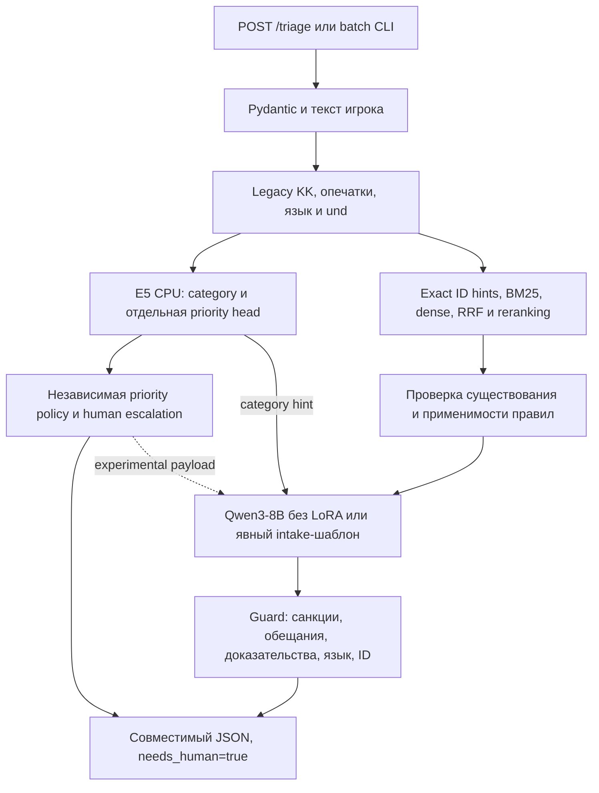

# Grand Mobile Support Copilot — технический отчёт, 31 октября 2026

Рабочий результат: локальные HTTP API и batch CLI сохранены, новый urgency-profile
включён по выбору пользователя, сравнение четырёх семейств классификаторов
выполнено. **Независимое улучшение качества реального потока не доказано**:
проверенных человеческих меток нет. После завершения проверки пользователь
подтвердил публикацию исходного кода и агрегированных отчётов в GitHub.
Исходные данные, производные выборки, веса и локальные артефакты остаются приватными.

## 1. Архитектура до изменений

FastAPI/Pydantic → allowlisted player text → эвристический language detector +
legacy-KK/typo normalization → frozen multilingual-e5-small CPU + category/priority
ridge → uncertainty keyword fallback и обязательные topic overrides → BM25/dense
RRF с событийными поправками → фильтр релевантности → Qwen3-8B Q4_K_M,
llama.cpp CUDA → citation/safety/language guard → `TriageResponse`.

Без проверенного правила выбирался intake-шаблон; неизвестный язык запрашивал
уточнение. Category/priority не принимались LLM. Admin и поля исхода не были
признаками. Ранний classifier-v1 использовал 777 примеров, включая 693keyword
weak targets и 84 авторских. Все черновики уже требовали человека.

## 2. Архитектура после изменений



Новый рабочий classifier-v2 обучен на 164 явно авторских intent-примерах,
без 693 исторических keyword targets. E5 и Qwen не изменялись в выбранной
конфигурации. Safe NPZ/manifest format и проверки taxonomy/encoder/weights
сохранены. Прямой CLI и PowerShell теперь по умолчанию выбирают этот профиль;
`-ClassifierProfile baseline` оставляет возможность сравнения с v1.

LLM остаётся генератором формулировки, не принимает решения и не выполняет
действия в игре. Реализован отдельный валидируемый payload `language/category/
priority/reported_metadata/needs_human/reported_facts_verified=false`.
Расширенный payload **экспериментальный и выключен по умолчанию**:
`COPILOT_GENERATION_DECISIONS=1`. Его проверка дала худший хвост задержки и больше
оборванных генераций. Рабочий промпт сохранён. Нельзя выдавать эту возможность
за улучшенную рабочую генерацию на всех языках.

## 3. Аудит и исправленные проблемы

План записан до новых правок: [AUDIT_PLAN.md](AUDIT_PLAN.md).
Инвентаризированы и синтаксически разобраны 82 Python-файла: runtime, scripts, tests;
проверены конфигурация, отчёты экспериментов, DOCX и весь handout.
Это инженерный аудит, не формальный pentest или доказательство отсутствия дефектов.

| Находка | Результат |
|---|---|
|Нет gold category/priority|Прочитаны 118337 train +1000 valid; подготовлен слепой пакет 49 без train-пересечений|
|Утечка при случайном split|Обнаружены 775 общих заявителей и 187 групп совпавших текстов train/valid; введён независимый review gate|
|Эталонный язык мог влиять на нормализацию признаков|Из скриптов удалена подсказка expected lang; допустимы только входные server_lang/region. На текущих164train и42eval строки не изменились, все измерения пяти моделей повторены и совпали|
|Нельзя сравнить методы|Обучены SVM, logistic и CatBoost на тех же 164, фиксированные параметры; confusion и разрезы сохранены|
|Приоритет смешан с engine|Выделен `priority.py`; модель может повышать срочность, но не понижать распознанный safety floor|
|Некоторые формулировки блокировки проходили guard|Добавлены русские формы блокировки, suspension/block и UZ bloklash; закрыт наблюдаемый небезопасный ответ|
|Нормативное утверждение без доступного источника|Guard теперь отклоняет его и при пустом списке rules|
|Показатель 2/16 неоднозначен|UI отдельно показывает category+p0 и только p0, проверяет согласованность числителей|
|Нет обязательного make target|Добавлен Makefile поверх существующего атомарного CLI|
|Отчёты смешивают наличие ID и смысл|Отдельно existence precision, authored allowlist proxy и неизмеренная semantic precision|

Полный анализ языков, опечаток, дублей и admin-шаблонов:
[DATA_AUDIT.md](DATA_AUDIT.md). Текущий detector слишком часто возвращает und
(53553/118337 train), из-за чего голова пропускается. Истинная доля ошибок языка
неизвестна: исходный `lang` тоже эвристический. Нужен отдельный CPU language
baseline и независимая разметка коротких/смешанных текстов; это не исправлено
слепым назначением ru всей кириллице.

В генерации нет admin/verdict/punishment/violation. Их чтение в **аудите данных**
служит лишь агрегации исходов/формы шаблонов. Обвинения и rule_refs игрока —
неподтверждённые сведения. `has_evidence` означает наличие счётчика вложений,
не просмотр или достоверность изображения. Небезопасный текст примера ответа
в DOCX не использован как поведенческая инструкция.

## 4. Сравнение метрик выбранной системы

Одинаковые 100 синтетических запросов HTTP и 42 классификации; это известные наборы
разработки, **не независимая оценка и не официальный valid**. Сохранены исходные
попытки, исключения, хеши кода/источников/сценариев, стабильность сервера.
Ошибки остаются в знаменателях; повторов до удачи нет.

| Метрика | До: base8B + v1 | После: base8B + v2 + guard |
|---|---:|---:|
|HTTP 200 и валидный JSON|100/100|100/100|
|Category accuracy,42|23/42 (54,76%)|23/42 (54,76%)|
|Category macro-F1|0,4776|0,4721|
|Priority macro-F1|0,7300|0,7200|
|p0 recall на прежних 6|6/6|6/6|
|p0 precision на 42|6/7|6/8|
|Псевдоссылки|0/100|0/100|
|Существующие ID / все процитированные|44/44|43/43|
|ID в авторском allowlist / процитированные|44/44|43/43|
|Нужная ссылка в итоговом ответе|44/63|43/63|
|Явные source-absent intake-шаблоны|31|31|
|Отвергнутый черновик → безопасный шаблон|16|17|
|Сообщённые ошибки генерации|2|2|
|Все наблюдаемые условия|77/100|76/100|
|needs_human|100/100|100/100|
|p50 / p95 всего потока, с|1,391 / 2,988|1,387 / 2,991|
|p50 / p95 только 61 попытки LLM, с|1,855 / 3,365|1,852 / 3,400|

Потерянная дополнительная ссылка относится к ответу, который рекомендовал
блокировку на несколько дней. Guard заменил его безопасным intake; ссылка к
шаблону автоматически не дописана. Это измеренный компромисс безопасности и
coverage, а не улучшение всех метрик. Existence/allowlist precision100% в этом
прогоне не означает semantic correctness100% или hallucination rate0%.

На известных stress16: прежний профиль давал **p0 в 3/16**, а одновременно
категория+p0 —**2/16**. Новая выбранная связка: **15/16** и **11/16**.
Пользователь явно предпочёл меньше пропусков критичных обращений, приняв
небольшое снижение общей macro-F1. Эти 16 уже использованы для оценки выбора,
не являются новым независимым holdout. Исходные более строгие условия замены
головы выполнены не полностью, что сохранено в приватном решении выбора.

End-to-end разрезы 42: RU7/14 категорий, priority macro-F1=0,5709;
KK8/14 и 0,8722; UZ8/14 и 0,7292. Complaint9/24 категорий, report14/18.
На 100 triage нужные ссылки RU12/17, KK15/21, UZ12/17, EN4/8.
Совпадение ожидаемого основного языка 100/100 измеряет только авторскую метку,
а не естественность речи. Полные confusion matrices и все разрезы находятся
в `.private/audit-v6/final-system-comparison.json`.

## 5. Кандидаты, которые не продвигаются

Чистые category heads на 42: SVM35,7%, E5/logistic78,6%, CatBoost69,0%,
текущий authored ridge71,4%. Это другая область измерения, чем 23/42HTTP:
в голове нет language gate/uncertainty fallback/topic override.
Logistic — кандидат для человеческой проверки, не доказанное улучшение
продакшена. [Методика и разрезы](../experiments/classifier-comparison/RESULTS.md).

Новый RU Qwen3-8B LoRA реально обучен 64 шага и проверен побайтно. На matched100
он дал 43/63 ссылок против 44/63 у базы, поэтому **отклонён**. Это отдельный
эксперимент до нынешнего усиления guard; нельзя приписывать ему нынешний
результат 43/63. [Обучение и доказательства](../experiments/finetune-v3/RESULTS.md).

Расширенный structured prompt:45/63 ссылок,3 обрыва вместо 2, p95 попыток LLM
**4,311 с против 3,365 с**. Общий p95=2,978 с скрывал ухудшение из-за смеси
быстрых шаблонов. Поэтому расширение не выбрано по умолчанию.

Retrieval ablation на одинаковых 63 случаях: exact-only0 (в этих запросах не было
подходящих явных ссылок), BM25 сquery-cues60, dense30, простойRRF57,
текущий hybrid+heuristic reranking61. Все метрики — coverage авторских ID,
не human relevance. Dense отдельно слабее; существующий гибрид сохраняется,
дорогой новый reranker без подтверждённого выигрыша не добавлен.

## 6. Тестирование и интеграция

- Полный финальный набор: **601 passed + 50 subtests, exit0**,18,64 с.
- `compileall` завершён успешно; Git diff проверен с корректным учётом CRLF.
- Настоящий batch на 3 придуманных RU/KK/UZ запросах:3 валидных JSON,
  ожидаемые языки, payment→p0 и обязательный human, exit0.
- Настоящий HTTP:100 triage +42 classify, затем 16stress +42 classify;
  оба запуска **exit2**, так как часть условий качества не выполнена.
  Это завершённые измерения, не успешное прохождение всех quality gates.
- `validate_review_packet` и human evaluation возвращают **exit2**:
 0/49 двойных человеческих разметок; human metrics=`null`.
- GNU Make в этой Windows-среде отсутствует: Makefile предоставлен, но сам
 `make predict` здесь не запускался. Его реальный Python/PowerShell batch
 backend проверен; на окружении с GNU Make нужно выполнить команду ниже.

Основной JSON-контракт и `POST /triage` сохранены. Schema/citation/secret/
promise/evidence/language регрессии проходят, но guards остаются поверхностными
эвристиками. Безопасный fallback не подменяется выдуманным ответом.

## 7. Стоимость и производительность

Внешний LLM API: **$0 на обращение**, все inference/training локальные. Данные
не отправлялись в облако. Электричество, амортизация ноутбука и полная стоимость
обработки не измерены; общая себестоимость не объявляется нулевой.

RTX3060Laptop6GB, Qwen3-8B Q4_K_M, один слот 1536 токенов, prompt≤1024,
ответ≤224, timeout45 с; E5-small384 наCPU, query LRU128/300 с. Не увеличены
размеры моделей или контекст. p95 всего потока 2,991 с — один последовательный
прогон; это не доказательство p95≤5 с под нагрузкой. Занятый сервис отвечает
503, бесконечная очередь не создаётся.

## 8. Запуск и воспроизведение

С готовыми приватными ресурсами из README:

```powershell
.\scripts\run-rag.ps1 -Action serve -ClassifierProfile critical -EvaluationReport .private/input-v4/metrics36.json
# http://127.0.0.1:8000 , /docs , /ready
```

Для batch сначала остановите HTTP-процесс модели, чтобы не грузить вторую 8B:

```powershell
.\scripts\run-rag.ps1 -Action predict -ClassifierProfile critical -InputPath .private/my-input.jsonl -OutputPath .private/my-output-new.jsonl
# С GNU Make и подготовленной средой:
make predict PYTHON=.venv-soup/Scripts/python.exe IN=.private/my-input.jsonl OUT=.private/my-output-new2.jsonl
```

Новое имя выхода обязательно: CLI не перезаписывает пользовательские файлы.
Полное воспроизведение требует приватных данных/моделей; clone сам их не содержит.

```powershell
.venv-soup/Scripts/python.exe -X utf8 -m pytest -q
.venv-soup/Scripts/python.exe -X utf8 scripts/evaluate_http_quality.py --output .private/quality-live/new100.jsonl --challenge .private/quality-live/challenge24.jsonl
.venv-soup/Scripts/python.exe -X utf8 scripts/compare_retrieval.py --output .private/new-retrieval.json
```

Приватные финальные доказательства: `audit-v6-final100-42.jsonl`,
`audit-v6-final16-42.jsonl`, `audit-v6/final-system-comparison.json`,
`classifier-comparison-v6-audited/results.json`, `audit-v6/source-inventory.json`.

## 9. Оставшиеся ограничения и следующий шаг

Человеческой blind draft quality, независимой real category accuracy, semantic
hallucination rate и оценки носителями KK/UZ **пока нет**. [Пакет 49 и протокол](REVIEW_PROTOCOL.md)
готовы, но проверяющего у команды сейчас нет. Ни один скрипт не заполняет
пробелы ответами LLM. Поэтому независимая проверенная выборка ещё не создана
в смысле завершённой разметки, а требование доказать общий прирост остаётся открытым.

Главные дальнейшие задачи: независимо разметить 49 и расширить gold, отдельно
проверить language detection, откалибровать category fallback на отдельном
train/dev и только затем сравнить logistic с рабочей категоризацией на слепом
test. Для генерации нужны исправленные сотрудниками ответы и носители, а не
дополнительные шаги обучения на непроверенных шаблонах.

Риск переноса смысла исключенийGZ на слишком широкий круг сотрудников остаётся.
Нет проверенного payment/access FAQ. Шесть языков игры целиком не поддержаны:
RU/KK/UZ/EN — рабочие черновики без native verification, прочие требуют уточнения.
Дедупликация только exact при наличии identity и корректного времени; полноценный
spam/semantic duplicate filter отсутствует. Реальные угрозы/массовые баги на всех
языках не проверены. Автономное закрытие и гарантированные санкции отключены.
