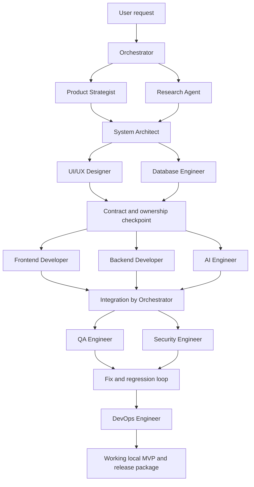

# Central orchestration workflow

This is a workflow interpreted by Codex, not a separate DAG execution engine.
The primary session performs the orchestrator role using project developer
instructions. `orchestrator` is also a registered native custom type for explicit
delegation from a different coordinating session; avoid spawning another orchestrator
inside this workflow because it duplicates coordination and consumes a slot.

1. **Intake.** Inspect the repository, preserve existing work, extract users, core
   journey, constraints, deadline and acceptance criteria. Ask only for information
   that blocks a sound implementation; label other assumptions. Create a run folder
   under `team/runs/<run-id>/` and a task plan. Do not pick a hackathon idea for the user.
2. **Discovery.** Spawn `product_strategist` and `research_agent` independently.
   Product returns the smallest demonstrable scope and acceptance criteria; research
   returns primary-source feasibility, compatible versions, limits and alternatives.
   Root records accepted results in `brief.md` and `research.md`.
3. **Architecture.** Delegate to `system_architect` after discovery. Root accepts a
   stack, module boundaries, API/data/AI interfaces, error shapes and test strategy.
   Record `architecture.md` and `contracts.md`; keep implementation proportionate to
   a hackathon. No distributed services unless the requirements justify them.
4. **Experience and data.** Delegate `ui_ux_designer` and `database_engineer` in
   parallel with disjoint ownership. UX returns flows, responsive layouts, tokens,
   keyboard/error/loading/empty states. Database returns schema, migration and seed
   strategy. Root reconciles contracts and records `design.md` and `data.md`.
5. **Implementation checkpoint.** Root scaffolds shared manifests, lockfiles, config
   and contracts before parallel writers. Define exact owned directories for
   `frontend_developer`, `backend_developer`, `ai_engineer`. Any nonapplicable role
   returns a reasoned N/A handoff instead of inventing unnecessary components.
6. **Parallel implementation.** Run up to three independent writers subject to the
   runtime's actual capacity. Give each accepted contracts and acceptance tests.
   Workers may request a shared change, but only the root applies it. Keep the root
   available for integration and decisions; do not duplicate delegated work.
7. **Integration.** Inspect accepted diffs, connect modules, install compatible
   dependencies using the existing package manager, create `.env.example` with
   placeholders, run migrations on disposable/local data, and verify the core path.
8. **Independent checks.** Run `qa_engineer` and `security_engineer` in parallel on
   the integrated revision. QA owns tests; security performs review without edits.
   Triage by severity. Return fixes to the owning developer, integrate, and rerun
   affected tests plus the core smoke test. Record unresolved findings explicitly.
9. **Delivery preparation.** Assign `devops_engineer` local startup, reproducible
   environment, CI appropriate to the chosen stack, health checks and release notes.
   Deploy publicly only when authorized; a local working MVP can satisfy this stage.
10. **Acceptance.** Root verifies clean startup and the agreed user journey, reports
    tests with actual results, setup commands, configuration requirements and known
    gaps. Never call a scaffold, mock-only path or failing build a working MVP.

If native custom roles are missing, stop and diagnose discovery/trust/configuration.
Do not silently replace them with Markdown personas and claim native verification.
If concurrency is unavailable, report it and run roles sequentially with the same
handoff checks. Runtime and managed policy limits always take precedence.
